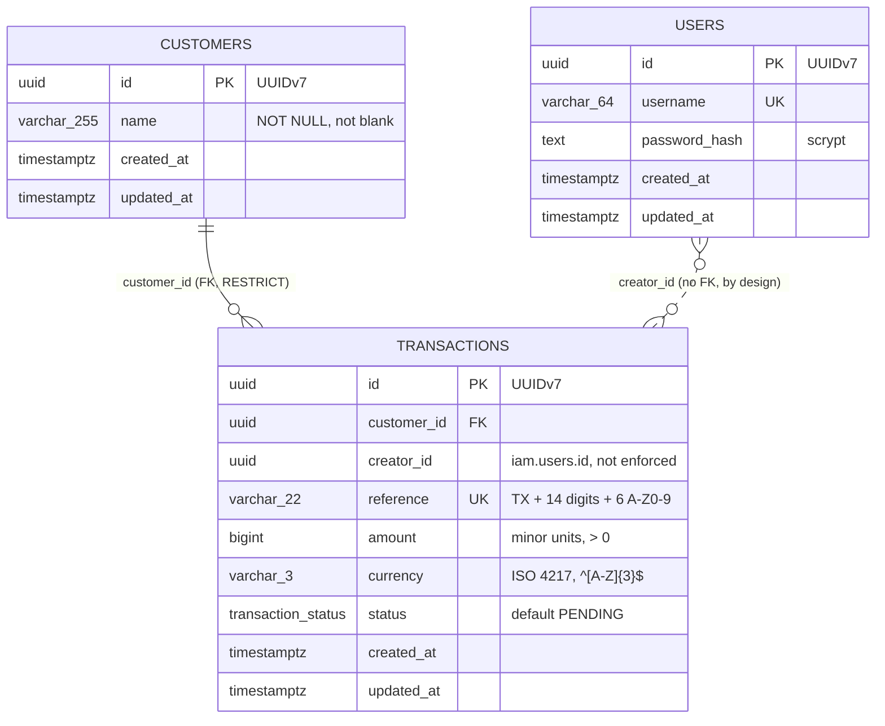

# Database

## Entity relationship

`finances` holds `customers` and `transactions`; `iam` holds `users`. The dotted
line is a logical reference only.

## Tables

### `finances.customers`

| Column                     | Type           | Constraints                                      |
|----------------------------|----------------|--------------------------------------------------|
| `id`                       | `uuid`         | primary key, UUIDv7 generated by the application |
| `name`                     | `varchar(255)` | `NOT NULL`, `CHECK (length(btrim(name)) > 0)`    |
| `created_at`, `updated_at` | `timestamptz`  | `NOT NULL`, default `now()`                      |

### `finances.transactions`

| Column                     | Type                          | Constraints                                                            |
|----------------------------|-------------------------------|------------------------------------------------------------------------|
| `id`                       | `uuid`                        | primary key, UUIDv7 generated by the application                       |
| `customer_id`              | `uuid`                        | `NOT NULL`, FK to `customers(id)` `ON DELETE RESTRICT`                 |
| `creator_id`               | `uuid`                        | `NOT NULL`, the user who created it; no foreign key                    |
| `reference`                | `varchar(22)`                 | `NOT NULL`, `UNIQUE`, `CHECK (reference ~ '^TX[0-9]{14}[A-Z0-9]{6}$')` |
| `amount`                   | `bigint`                      | `NOT NULL`, `CHECK (amount > 0)`, in minor units                       |
| `currency`                 | `varchar(3)`                  | `NOT NULL`, `CHECK (currency ~ '^[A-Z]{3}$')`                          |
| `status`                   | `finances.transaction_status` | `NOT NULL`, default `'PENDING'`                                        |
| `created_at`, `updated_at` | `timestamptz`                 | `NOT NULL`, default `now()`                                            |

`finances.transaction_status` is an enum: `PENDING`, `APPROVED`, `REJECTED`.

### `iam.users`

| Column                     | Type          | Constraints                           |
|----------------------------|---------------|---------------------------------------|
| `id`                       | `uuid`        | primary key, UUIDv7                   |
| `username`                 | `varchar(64)` | `NOT NULL`, `UNIQUE`                  |
| `password_hash`            | `text`        | `NOT NULL`, scrypt (`salt:hash`, hex) |
| `created_at`, `updated_at` | `timestamptz` | `NOT NULL`, default `now()`           |

## Indexes

| Index                                 | Columns                           | Serves                                                            |
|---------------------------------------|-----------------------------------|-------------------------------------------------------------------|
| `transactions_reference_key` (unique) | `reference`                       | Uniqueness, lookup by reference                                   |
| `transactions_created_idx`            | `created_at`                      | The default list: newest first, no filter                         |
| `transactions_status_created_idx`     | `status, created_at`              | Status filter with the default sort                               |
| `transactions_customer_created_idx`   | `customer_id, created_at`         | Customer filter with the default sort                             |
| `transactions_creator_created_idx`    | `creator_id, created_at`          | "Transactions created by a user"; not used by the current API     |
| `transactions_reference_trgm_idx`     | `reference` (GIN, `gin_trgm_ops`) | `ILIKE '%term%'` search                                           |
| `customers_name_trgm_idx`             | `name` (GIN, `gin_trgm_ops`)      | `ILIKE '%term%'` search on customer name, and the customer lookup |

In the composite indexes I put the equality column first and `created_at`
second, so one index satisfies both the filter and the `ORDER BY`. The trigram
indexes need the `pg_trgm` extension, which my first migration creates.

At the seed size (200 rows) Postgres will choose a sequential scan whatever
indexes exist; I sized the indexes for realistic volumes, not for the demo.
